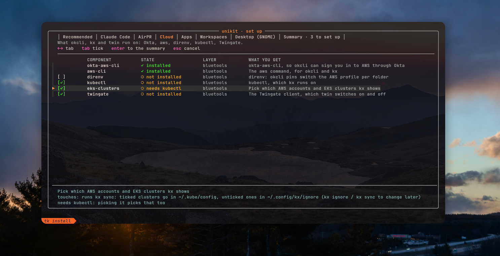
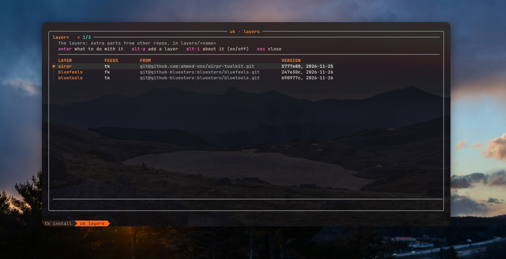
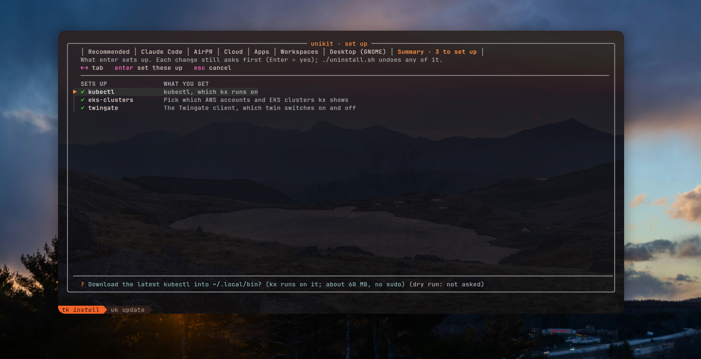
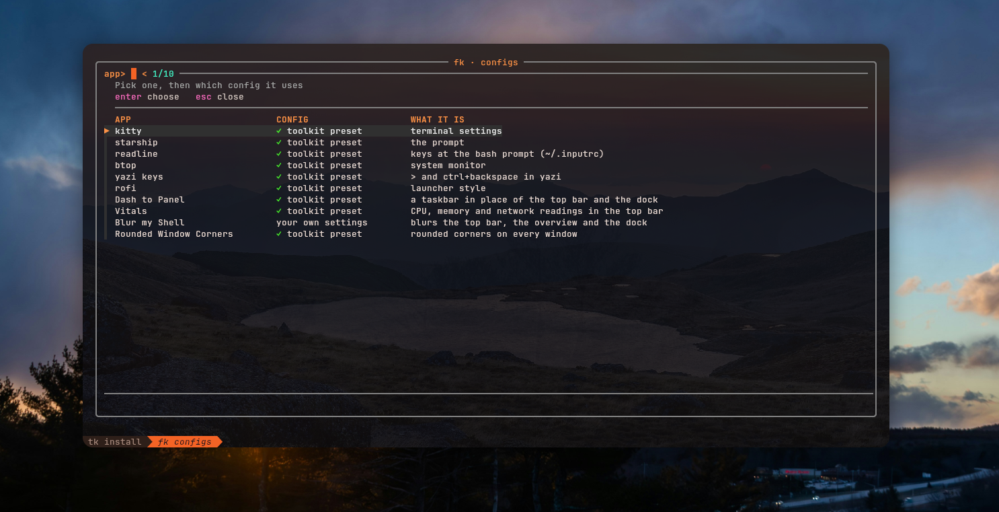

# unikit

**A shell toolkit you build from layers.** Every choice is a list you pick from, nothing changes
without asking, and everything can be undone.

unikit is the small base. The tools themselves come from **layers**: separate repos you add,
like `bluetools` for work tools, `bluefeels` for the look, or one you write for your own team.



<br>

## Why you'll like it

- 🎯 **Pick, don't type.** Every command opens a list. Questions show up inside the list, so you never lose your place.
- 🛡️ **Nothing changes without asking.** Every change asks first, and `--dry-run` shows what would happen.
- ↩️ **Everything undoes.** Uninstalling puts back exactly what you had before, files and settings alike.
- 🔁 **Safe to run again.** A second run sets up only what's missing and leaves the rest alone.
- 🧩 **Built from layers.** Keep your team's commands, repos and settings in a repo of your own. unikit never changes for them.
- 🔍 **You see code before it runs.** A layer is pinned to the commit you trusted, and updates show you what changed first.
- ✏️ **Your tweaks win.** Your own changes to any preset live in a patch file that updates never touch.

<br>

## How it fits together

| Command | Is | Filled by |
|---|---|---|
| `uk` | the base: adds, updates and checks layers | unikit |
| `tk` | **toolkit**, what you work with | layers like bluetools |
| `fk` | **feelkit**, how it looks | layers like bluefeels |

### Layers

The kits are empty until a layer fills them. These are the ones to start with:

| Layer | Kit | What it brings |
|---|---|---|
| [bluetools](https://github.com/bluestero/bluetools) | `tk` | AWS profiles, Kubernetes per terminal, Twingate, workspaces in your IDE, accounts per folder |
| [bluefeels](https://github.com/bluestero/bluefeels) | `fk` | kitty, the shell prompt and keys, the GNOME desktop |
| your own layer | either | your team's commands, repos and settings ([write one](docs/LAYERS.md)) |



<br>

## Get it

Made for Ubuntu with GNOME. unikit and bluetools only need bash and Linux; on other systems the
installer marks what can't run there.

```bash
sudo apt install git curl                                     # if you don't have them

git clone https://github.com/bluestero/unikit.git ~/unikit   # 1. download it (any folder you'll keep)
~/unikit/install.sh                                           # 2. pick layers, then what to set up
```

The first run offers the two layers above, nothing ticked; skip them and it offers them again next
time. Later, add one with `uk layer add bluetools` (or `bluefeels`, or any layer's git URL).
Nothing changes without asking. Then open a new terminal: `uk status` shows what's set up, and
`fk install` sets up bluefeels' look.

Removing it is `tk uninstall` (or `fk uninstall`): pick what goes, and what you had comes back.



More options, how updates work and what each part sets up are in **[docs/INSTALL.md](docs/INSTALL.md)**.

<br>

## Everyday commands

| Command | What it does |
|---|---|
| `uk status` | where unikit is, your layers, how much is set up |
| `uk layers` | add, set up or remove layers |
| `uk update` | get what's new, with changed code shown first |
| `uk doctor` | check everything; each problem comes with its fix |
| `uk skills` | choose which Claude profiles get which skills |
| `tk`, `fk` | pick any command in the kit and run it |
| `tk install`, `fk install` | set up parts (`uninstall` removes them) |
| `fk configs` | switch a preset: the layer's, the app's default, or yours |

Every command and key: **[docs/COMMANDS.md](docs/COMMANDS.md)**.

<details>
<summary><b>See <code>uk update</code> and <code>fk configs</code></b></summary>
<br>




</details>

<br>

## Build your own

| You want to | Read |
|---|---|
| write a layer for your team or yourself | [docs/LAYERS.md](docs/LAYERS.md), starting from [docs/layer-template/](docs/layer-template) |
| change unikit itself | [docs/DEVELOPING.md](docs/DEVELOPING.md) |
| have an AI agent build a layer | point it at [CLAUDE.md](CLAUDE.md) (the UI rules) and [docs/LAYERS.md](docs/LAYERS.md) (the contract) |
